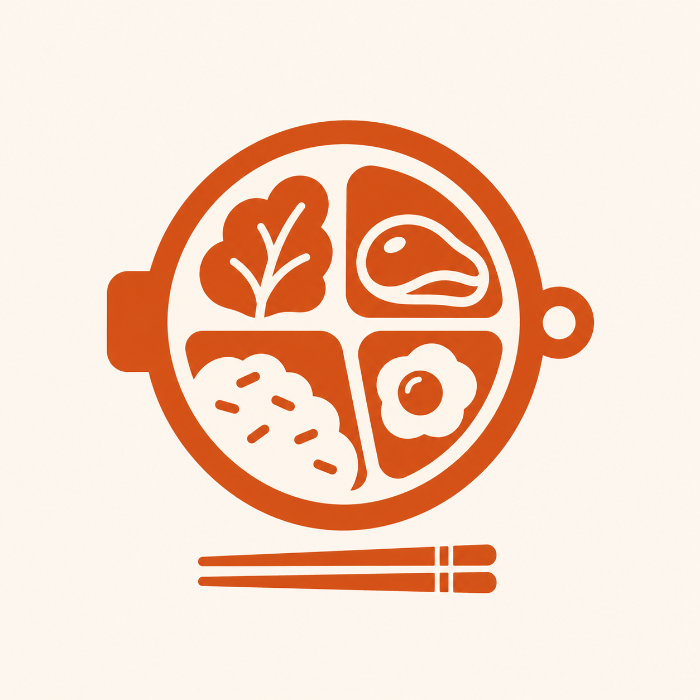

# Hợp đồng API

<p align="center">
  
</p>

Base URL: `/api/v1`

Mọi request/response dùng JSON. Mọi field thời gian là chuỗi ISO 8601 UTC.

## Quy ước lỗi

```json
{ "error": "MÃ_LỖI", "message": "Mô tả cho người dùng", "details": { "field": "..." } }
```

| HTTP | `error` | Khi nào |
|---|---|---|
| 400 | `VALIDATION_ERROR` | Body/query sai schema (zod) |
| 401 | `UNAUTHENTICATED` | Thiếu hoặc hết hạn access token |
| 403 | `FORBIDDEN` | Đúng token nhưng không đủ quyền |
| 404 | `NOT_FOUND` | Không tìm thấy tài nguyên |
| 409 | `CONFLICT` | Email đã tồn tại, trùng lịch bữa |
| 429 | `RATE_LIMITED` | Quá nhiều lần thử đăng nhập |
| 500 | `INTERNAL` | Lỗi không lường trước (không lộ stack trace) |

## Endpoint

### Hệ thống

| Method | Path | Auth | Mô tả |
|---|---|---|---|
| GET | `/ping` | — | Kiểm tra server sống |
| GET | `/health` | — | *(không tiền tố)* trạng thái + uptime, dùng cho Docker healthcheck |

### Auth

| Method | Path | Auth | Mô tả |
|---|---|---|---|
| POST | `/auth/register` | — | Đăng ký bằng email + mật khẩu |
| POST | `/auth/login` | — | Trả access token (15 phút) + refresh token (7 ngày) |
| POST | `/auth/refresh` | refresh | Cấp lại access token |
| POST | `/auth/logout` | access | Thu hồi refresh token hiện tại |
| GET | `/auth/me` | access | Thông tin user đang đăng nhập |

### Gia đình

| Method | Path | Auth | Mô tả |
|---|---|---|---|
| POST | `/families` | access | Tạo gia đình (người tạo thành Owner) |
| GET | `/families/current` | access | Gia đình của user hiện tại |
| POST | `/families/join` | access | Tham gia bằng mã mời |
| PATCH | `/families/current` | owner | Đổi tên gia đình |

### Công thức

| Method | Path | Auth | Mô tả |
|---|---|---|---|
| GET | `/recipes` | access | Danh sách, hỗ trợ `?q=&tag=&page=&limit=` |
| GET | `/recipes/:id` | access | Chi tiết |
| POST | `/recipes` | access | Tạo mới |
| PATCH | `/recipes/:id` | access | Cập nhật |
| DELETE | `/recipes/:id` | access | Xoá (chỉ người tạo hoặc owner) |
| POST | `/recipes/:id/image` | access | Lấy presigned URL để upload ảnh |

### Thực đơn

| Method | Path | Auth | Mô tả |
|---|---|---|---|
| GET | `/meal-plans?from=&to=` | access | Thực đơn trong khoảng ngày |
| POST | `/meal-plans` | access | Thêm một bữa vào lịch |
| PATCH | `/meal-plans/:id` | access | Đổi món, đổi ngày, đổi số phần |
| DELETE | `/meal-plans/:id` | access | Bỏ bữa khỏi lịch |

### Đi chợ

| Method | Path | Auth | Mô tả |
|---|---|---|---|
| GET | `/shopping-list?from=&to=` | access | Gộp nguyên liệu cả tuần, đã quy đổi đơn vị |

## Quy ước phân trang

Request: `?page=1&limit=20` (limit tối đa 100).
Response:

```json
{ "items": [], "meta": { "page": 1, "limit": 20, "total": 0 } }
```

> Ghi chú: file này là **hợp đồng**, viết trước khi code API. Mọi thay đổi phải sửa file này trước, rồi mới sửa `packages/shared` và hai phía.
